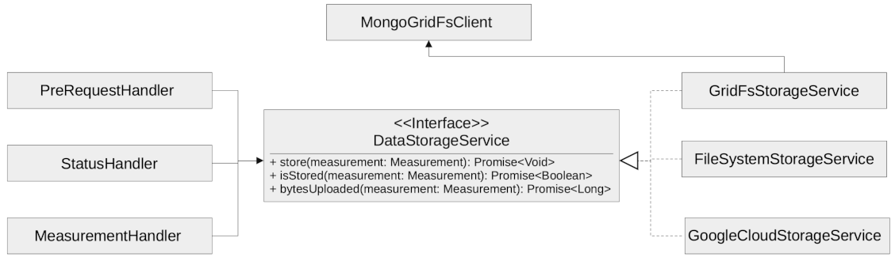

# Module collector


This application represents the [Cyface](https://cyface.de) data collector software.

It is used to collect traffic data from Cyface measurement devices, such as our smartphone application.

Our smartphone SDK is available as GPL application for [Android](https://github.com/cyface-de/android-backend) and [iOS](https://github.com/cyface-de/ios-sensor-library) as well.

If you require this software under a closed source license for you own projects, please [contact us](https://www.cyface.de/#kontakt).

Changes between versions are found in the [Release Section](https://github.com/cyface-de/data-collector/releases).

The project uses [Gradle](https://gradle.org/) as the build system.

This README is also the module documentation of the Dokka API documentation (`includes.from("README.md")` in `build.gradle.kts`). Keep the headings `# Module collector` and `# Package ...`.

## Overview

* [Collector](#collector)
* [Architecture](#architecture)
* [Development](#development)
* [GitHub Workflows](#github-workflows)
* [Release a new Version](#release-a-new-version)
* [Publishing Artifacts to GitHub Packages manually](#publishing-artifacts-to-github-packages-manually)
* [To Do](#to-do)
* [Licensing](#licensing)

## Collector

A program which provides the ability to collect data, as e.g. sent by the Cyface SDKs.

The following sections explain how to run the Data Collector
It starts with an explanation on how to set up all the required steps.
This is a necessary prerequisite for all the following steps.
So **DO NOT** skip it.

Thereafter, follows an explanation on how to run the Data Collector using either Docker or an IDE like IntelliJ or Eclipse.

### Building

To build the docker container running the API simply execute `./gradlew :clean :build :copyToDockerBuildFolder`.
This builds the jar file which is then packed into the Docker container which is build afterwards.

When you updated the Swagger UI make sure to clear your browser cache or else it might not update.

### Execution
This section describes how to execute the Cyface Data Collector.

It begins with an explanation on how to run the Cyface Data Collector from a Docker environment.
This is the recommended variant if you do not need to change the collector itself, but only need to develop against its API.

The section continues with an explanation on the supported configuration parameters.
If you are not using the Docker environment, you will probably have to set a few of them to the correct values, before running the Cyface Data Collector.

The last two sections provide explanations on how to run the software directly from the terminal or from within an IDE such as Eclipse or IntelliJ.
For these execution variants you need the parameters explained in the preceding section.

#### Authentication

The Cyface Data Collector supports two authentication methods:

* **JWT** (`auth.type` = `jwt`): the collector validates the tokens against a set of JSON Web Keys (`auth.jwks`).
* **OAuth** (`auth.type` = `oauth`, the default): the collector uses a Keycloak or other OIDC provider (`auth.site`, `auth.tenant`, `auth.client`, `auth.secret`).

#### Running from Docker

Decide if you need JWT or OAuth Authentication.

Configure logback or use the sample configuration for either JWT or OAuth: 
* `cp src/main/docker/container-jwt/logback.xml.template src/main/docker/container-jwt/logback.xml` 
* `cp src/main/docker/container-oauth/logback.xml.template src/main/docker/container-oauth/logback.xml`

The app is executed by a non-privileged user inside the Docker container. To allow this user to
write data to `logs` and `file-uploads` you need to create two folders and then set the permissions for both folders to `chmod o+w`, see [DAT-797].
Do this for either JWT or OAuth authentication using one of the two following commands:
* `mkdir src/main/docker/container-jwt/logs src/main/docker/container-jwt/file-uploads && sudo chmod  o+w src/main/docker/container-jwt/file-uploads src/main/docker/container-jwt/logs`
* `mkdir src/main/docker/container-oauth/logs src/main/docker/container-oauth/file-uploads && sudo chmod  o+w src/main/docker/container-oauth/file-uploads src/main/docker/container-oauth/logs`

Now build the system as described in the "Building" section above:
`./gradlew :clean :build :copyToDockerBuildFolder`

For the JWT setup you need to create an environment variable named `CYFACE_JWKS` and set it to the JSON array of JWKs from your auth server.
For example use something like this:
```
export CYFACE_JWKS='[{"kty":"RSA","alg":"RS256","use":"sig","kid":"beta-2024","n":"a-very-long-string-containing-the-actual-public-key","e":"AQAB"}]'
```
Each JWK in the array must have a unique `kid` value so that Vert.x can select the correct key from the JWT header.
If you only have a single key you may also use the legacy variable `CYFACE_JWK` (a single JSON object without the surrounding array brackets); `CYFACE_JWKS` takes precedence when both are set.

Then simply run `docker-compose up` inside `build/docker` for either JWT or OAuth authentication:
* `cd build/docker/ && docker compose -f compose-jwt.yaml up -d --build --force-recreate`
* `cd build/docker/ && docker compose -f compose-oauth.yaml up -d --build --force-recreate`

This calls docker to bring up a Mongo-database container and a container running the Cyface data collector API. 
The Options `--build` and `--force-recreate` ensure that the latest version of the Cyface data collector is used and that the containers are recreated, even if they already exist.
The Collector API is by default available via port 8080. 
This means if you boot up everything using the default settings, the Collector API is accessible via `http://localhost:8080/api/v4/`.

**ATTENTION: The docker setup should only be used for development purposes.**

By default the API port is bound to `127.0.0.1` (localhost only).
To reach the collector from a physical phone on the same Wi-Fi network, copy the
environment template and enable LAN exposure:

```bash
cp src/main/docker/.env.template src/main/docker/.env
# Then uncomment API_BIND_ADDRESS=0.0.0.0 in .env
```

The `.env` file also lets you select JWT or OAuth via `COMPOSE_FILE` so you can
run plain `docker compose up` without `-f` flags. See `.env.template` for details.

**Do not set `API_BIND_ADDRESS=0.0.0.0` on shared or public Wi-Fi** -- it opens
the port to everyone on the network.

Use `docker-compose ps` to see which ports are mapped to which by Docker.
For using such a setup in production, you may create your own Docker setup, based on our development one.

#### Running without Docker
Running the Cyface Data Collector without Docker, like for example from the terminal or from within your IDE is a little more complex.
It requires a few set up steps and command knowledge as explained in the following paragraphs.

**Running a Keycloak instance for Authentication:** For OAuth, a Keycloak instance must run and be accessible, see the service `authentication` in `src/main/docker/compose-oauth.yaml`.

Copy the `src/main/resources/logback.xml.template` to `logback.xml` and adjust if needed.

##### Running a Mongo Database for Data and User Storage
Before you can run the Cyface data collector you need to set up a Mongo database.

If you use the Docker environment as explained above, this is done for you.
If you run the Cyface Data Collector on your own, you are responsible for providing a valid environment, including Mongo.

The database is used to store the collected data and information about valid user accounts.
For information on how to install and run a Mongo database on your machine please follow the [tutorial](https://docs.mongodb.com/manual/installation/#mongodb-community-edition).
If you take the default installation, the default settings of the Cyface data collector should be sufficient to connect to that instance.
**ATTENTION: However be aware this is not recommended as a production environment.**

##### Running a Google Cloud Store for Data
As an alternative for storing data to a Mongo GridFS database, the Cyface Data 
Collector provides the possibility to use Google Cloud Storage for storing received data.

You may configure this as explained in the section about valid arguments.
Notice however that a Mongo database is still required to store user data for authentication and authorization as explained above.

###### Development Environment

You can use your Google Admin Account to test the Google Cloud Storage locally.

1. [Install gcloud CLI](https://cloud.google.com/sdk/docs/install?hl=de#deb)
   a. Confirm with `y` to log in with your Google Cloud Admin Account
   b. Pick a Google Cloud Project, e.g. `Object Storage Staging`
   c. Use the default compute region and zone.
   d. The result of the previous step is a `.boto` file.
2. Now [log into](https://cloud.google.com/storage/docs/reference/libraries#client-libraries-install-java) your Account with the `gcloud` shell
   a. `gcloud auth application-default login`
   b. You may ignore if the following error occurs: `RESOURCE_EXHAUSTED: Quota exceeded`
   c. The result is `~/.config/gcloud/application_default_credentials.json`  
3. Link the credentials file in the Collector
   a. Set `credentialsFileLocation=/home/user/..._credentials.json` 

###### Production Environment

The production uses a Service Account to upload data to the Google Cloud Storage.
The credentials are stored at the typical location under `Development > Google Cloud`.
For more details about how to set up a Service Account, see `Confluence > Google Object Storage`.

1. Link the private key from the service account `json` key in the Collector 
   a. Set `credentialsFileLocation=/home/.../object-storage-412713-***.json`
2. Test by executing the `GoogleCloudStorageIT` Test.
   a. Comment `@Ignore` out. 

#### Data Collector Arguments
The Cyface data collector requires a few parameters to fine tune the runtime.
The parameters are provided using the typical [Vertx `-conf` parameter](https://vertx.io/docs/vertx-core/java/#_the_vertx_command_line) with a value in JSON notation.

The following parameters are supported:

* **http.port:** The port the API  is available at.
* **http.host:** The hostname under which the Cyface Data Collector is running. This can be something like `localhost`.
* **http.endpoint:** The path to the endpoint the Cyface Data Collector.
* **mongo.db:** Settings for a Mongo database storing information about all the users capable of logging into the system and all data uploaded via the Cyface data collector. This defaults to a Mongo database available at `mongodb://127.0.0.1:27017`. The value of this should be a JSON object configured as described [here](https://vertx.io/docs/vertx-mongo-client/java/#_configuring_the_client).
* **metrics.enabled:** Set to either `true` or `false`. If `true` the collector API publishes metrics using micrometer. A [Prometheus](https://prometheus.io/) server (which you need to set up yourself) can read these metrics at port `8081`, path `/metrics`.
* **upload.expiration:** The time an interrupted upload is stored for continuation in the future in milliseconds. If this time expires, the upload must start from the beginning.
* **measurement.payload.limit:** The size of a measurement in bytes up to which it is accepted as a single upload. Larger measurements are transmitted in chunks.
* **storage-type:** The type of storage to use for the uploaded data. Currently, either `gridfs` or `google` is supported. The following parameter are required:
  * **gridfs**
    * **type:** Must be `gridfs` in this case.
    * **uploads-folder:** The relative or absolute path to a folder, to store temporary not finished uploads on the local hard drive before upload of the complete data blob to GridFS upon completion.
  * **google**
    * **type:** Must be `google` in this case.
    * **collection-name:** The name of a Mongo collection to store uploads' metadata into.
    * **project-identifier:** A Google Cloud Storage project identifier to where the upload bucket is located.
    * **bucket-name:** The Google Cloud Storage bucket name to load the data into.
    * **credentials-file:** A credentials file used to authenticate with the Google Cloud Storage account used to upload the data to the Cloud.
    * **buffer-size:** The size of the internal data buffer in bytes. 
    This is the amount of bytes the system accumulates before sending data to Google. 
    Low values decrease the possibility of data loss and the memory footprint of the application but increase the number of requests to Google. 
    Large values increase the memory footprint and may cause data loss in case of a server crash, but also cause a much more efficient communication with Google. 
    A value of 500 KB is recommended.
  * **local** For local file system storage of the data. This is only a placeholder and not fully implemented yet.
* **auth** 
  * **type:** One of "oauth", "jwt". The type of authentication service to use. Defaults to `oauth`. Requires some of the following parameters.
  * **callback:** Used for oauth type. The callback URL you entered in your provider admin console. This defaults to `http://localhost:8080/callback`.
  * **client:** Used for oauth type. The name of the oauth client to contact. This defaults to `collector`.
  * **secret:** Used for oauth type. The secret of the oauth client to contact.
  * **site:** Used for oauth type. The Root URL for the provider without trailing slashes. This defaults to `https://auth.cyface.de:8443/realms/{tenant}`.
  * **tenant:** Used for oauth type. The name of the oauth realm to contact. This defaults to `rfr`.
  * **jwks:** Used for jwt type. A JSON array of JSON Web Key objects. Each key needs a unique `kid`.

#### Running from Command Line

To launch your tests:

```
./gradlew clean test
```

To package your application:

```
./gradlew clean assemble
```

To run your application with the settings from `conf.json`:

```
./gradlew run --args="run de.cyface.collector.verticle.MainVerticle -conf conf.json"
```

#### Running from IDE
To run directly from within your IDE you need to use the `de.cyface.collector.Application` class, which is a subclass of the [Vert.x launcher](https://vertx.io/docs/vertx-core/java/#_the_vert_x_launcher). Just specify it as the main class in your launch configuration with the program argument `run de.cyface.collector.verticle.MainVerticle`.

### Mongo Database

#### Setup
The following is not strictly necessary but advised if you run in production or if you encounter strange problems related to data persistence.
Consider reading the [Mongo Database Administration Guide](https://docs.mongodb.com/manual/administration/) and follow the advice mentioned there.

#### Administration
To load files from the Mongo GridFS file storage use the [Mongofiles](https://docs.mongodb.com/manual/reference/program/mongofiles/) tool.

* Showing files: `mongofiles --port 27019 -d cyface list`
* Downloading files: `mongofiles --port 27019 -d cyface get f5823cbc-b8f5-4c80-a4b1-7bf28a3c7944`
* Unzipping files: `printf "\x78\x9c" | cat - f5823cbc-b8f5-4c80-a4b1-7bf28a3c7944 | zlib-flate -uncompress > test2`

## Using the Cyface Data Collector

To provide data to the Cyface Data Collector, call the appropriate endpoints of the Data Collector REST API.

The available endpoints are documented as OpenAPI.
The OpenAPI documentation is available under 'http://localhost:8080/api/v4/` if the collector runs under `localhost`.

The protocol for uploading data follows the [Google data protocol](https://developers.google.com/gdata/docs/resumable_upload).

### Accessing the Docker Development Environment
In the Docker development environment, all containers communicate through the internal Docker networks.

Tokens issued to a client outside this network won't be valid within the network due to a mismatch in the issuer encoded into the token.
For instance, it might use "localhost:8081" instead of the expected "authentication:8080" when requesting a token from outside.
The `rfr` realm, which is initialized in this setup from `./src/main/docker/keycloak/data/import/rfr-realm_<version>_see-keycloak-image-repo.json` (a copy of the realm in the repository `keycloak-image`), addresses
this problem by setting the "frontendUrl" to "http://authentication:8080". If you add more realms, ensure you do the same. 

To obtain an authentication token from outside the Docker network, you can use the following command:
```
$ curl -d 'scope=openid' -d 'client_id=ios-app' -d 'username=test@cyface.de' -d 'password=test' -d 'grant_type=password' 'http://localhost:8081/realms/rfr/protocol/openid-connect/token'
```

The output will look similar to this (tokens shortened):
```
{"access_token":"eyJhbGciOiJSUzI1NiIsInR5cCIgOiAiSldUIiwia2lkIiA6ICJDSnNhZ0ZnbGNGRnpDWTU1Z3ZYb2xhMnRMWFlDMzNDQmtUU05tMU1DbkdnIn0...","expires_in":300,"refresh_expires_in":86313600,"refresh_token":"eyJhbGciOiJIUzI1NiIsInR5cCIgOiAiSldUIiwia2lkIiA6ICJlMDEwYzQ2NS04YTRjLTQ3NzItODY2MS01NThkNWZhNGZmYTEifQ...","token_type":"Bearer","session_state":"a5fe6a2c-a402-4ae3-ad51-c359d911e7da","scope":"profile email"}
```
From this it is possible to copy the access token and start the upload process.

## Architecture

The Data Collector is a **Vert.x 4 / Kotlin reactive REST API**. It receives traffic measurement data from the Cyface mobile SDKs and stores it in MongoDB (GridFS) or Google Cloud Storage.

Startup flow: `Application.java` (Vert.x launcher, also starts the Prometheus metrics server) -> `MainVerticle` (deploys auth and storage) -> `CollectorApiVerticle` (HTTP router and endpoints) -> request `Handler` classes -> `DataStorageService`

| Package | Responsibility |
|---|---|
| `verticle/` | Vert.x verticles: `MainVerticle` (entry point), `CollectorApiVerticle` (API wiring), `HttpServer` (server setup) |
| `handler/` | HTTP request handlers for each endpoint; the sub-package `upload/` has `PreRequestHandler`, `StatusHandler`, `UploadHandler` |
| `auth/` | Pluggable auth: `MultiJWKAuthHandlerBuilder` (JWT), `OAuth2HandlerBuilder` (Keycloak), `MockedHandlerBuilder` (tests) |
| `storage/` | `DataStorageService` interface and implementations: `gridfs/` (MongoDB GridFS, default), `cloud/` (Google Cloud Storage), `local/` (placeholder) |
| `model/` | Domain model: `Measurement`, `Attachment`, `Upload`, `ContentRange`, `FormAttributes`, and `metadata/` subtypes |
| `configuration/` | `Configuration` maps `conf.json` to a typed configuration; `StorageType` sealed hierarchy |

The upload follows the [Google resumable upload protocol](https://developers.google.com/gdata/docs/resumable_upload) in more than one step: `PreRequestHandler` starts the upload and stores the session state in MongoDB, `UploadHandler` receives the chunks, `StatusHandler` reports the progress. `CleanupOperation` implementations remove stale uploads.

## Development

Copy the templates before the first build:

```bash
cp conf.json.template conf.json
cp src/main/resources/logback.xml.template src/main/resources/logback.xml
cp gradle.properties.template gradle.properties  # then add your GitHub credentials (gpr.user, gpr.key)
```

Commands:

```bash
./gradlew clean test                                       # all tests
./gradlew test --tests de.cyface.collector.SomeTestClass   # one test class
./gradlew detekt                                           # static analysis
./gradlew :clean :build :copyToDockerBuildFolder           # fat JAR and Docker artifacts
```

The tests use Testcontainers. With Docker 29 or newer, set `JAVA_TOOL_OPTIONS=-Dapi.version=1.44` until Testcontainers is updated.

Code quality rules (Detekt, `config/detekt.yml`, baseline `detekt-baseline.xml`):

- Line length: 120 characters at most
- Cyclomatic complexity: 15 at most
- Function length: 60 lines at most (without tests)
- Forbidden comments: `FIXME`, `TODO`, `STOPSHIP`

## GitHub Workflows

- `gradle_build.yml` -- builds and tests each push and pull request to `main` and `release-*`. Pull requests from forks are skipped.
- `gradle_publish.yml` -- runs on version tags: publishes the artifacts to GitHub Packages and creates the GitHub release.

Rules of the workflows (hardening of CY-6748):

- Do not use `${{ github.ref_name }}` or other event values directly in a `run:` script. Pass them through `env:` (for example `TAG`) and use `"$TAG"`.
- Pass secrets through `env:` of the step that needs them, not through the script text.
- The runner is pinned to `ubuntu-26.04`, not `ubuntu-latest`.

The organization-wide cleanup in `cyface-de/production` (`.github/workflows/registry_cleanup.yml`) deletes old package versions. A version that a build or deployment file of the organization names stays.

## Release a new Version

To release a new version:

* The CI sets the `version` in `build.gradle.kts` and in `src/main/resources/webroot/api/openapi.yml` from the tag. Do not change them manually.
* Create an annotated tag with a semantic version (for example `7.10.1`) on the `main` branch. Follow the guidelines from ["Keep a Changelog"](https://keepachangelog.com) in the tag message.
* Push the tag to GitHub. The workflow `gradle_publish.yml` publishes the artifacts to [GitHub Packages](https://github.com/cyface-de/data-collector/packages).
* The workflow then creates the GitHub release. The body of the tag message becomes the release notes. A tag with a suffix (for example `7.10.1-beta1`) becomes a pre-release.


## Publishing artifacts to GitHub Packages manually

The artifacts produced by this project are distributed via [GitHubPackages](https://github.com/features/packages).
Before you can publish artifacts you need to rename `gradle.properties.template` to `gradle.properties` and enter your GitHub credentials.
Use a personal access token (classic) with the scope `write:packages`, as described [here](https://docs.github.com/en/packages/working-with-a-github-packages-registry/working-with-the-gradle-registry#authenticating-to-github-packages).

To publish a new version of an artifact you need to:

1. Increase the version number in the `build.gradle.kts` file
2. Call `./gradlew publish`

This will upload a new artifact to GitHub packages with the new version.
GitHub Packages will not accept to overwrite an existing version or to upload a lower version.
This project uses [semantic versioning](https://semver.org/).

## To Do
* Setup Cluster
	* Vertx
	* MongoDb

## Licensing
Copyright 2018-2026 Cyface GmbH

This file is part of the Cyface Data Collector.

The Cyface Data Collector is free software: you can redistribute it and/or modify
it under the terms of the GNU General Public License as published by
the Free Software Foundation, either version 3 of the License, or
(at your option) any later version.

The Cyface Data Collector is distributed in the hope that it will be useful,
but WITHOUT ANY WARRANTY; without even the implied warranty of
MERCHANTABILITY or FITNESS FOR A PARTICULAR PURPOSE.  See the
GNU General Public License for more details.

You should have received a copy of the GNU General Public License
along with the Cyface Data Collector.  If not, see http://www.gnu.org/licenses/.

# Package de.cyface.collector.handler

This package contains the Vert.x handler classes used to handle various
* events during the runtime of the application. Usually those handlers react to
* events triggered by clients calling API endpoints.

# Package de.cyface.collector.model

Contains all the data model files required by the Cyface Data Collector.

# Package de.cyface.collector.storage

Contains the interface to store data in Cyface and several implementations for that interface.

Those implementations provide support for storing data in GridFS, on the local file system and in Google Cloud storage.

The following image shows an overview of the interface and how it is embedded in the Cyface data collector.



# Package de.cyface.collector

This package contains the top level classes used by the Cyface Data Collector. Most important is the class
* [de.cyface.collector.Application], which starts the whole application and the
* [de.cyface.collector.verticle.CollectorApiVerticle] that initializes the server.
